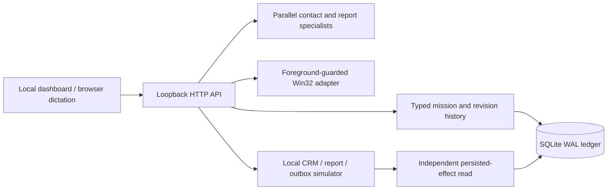
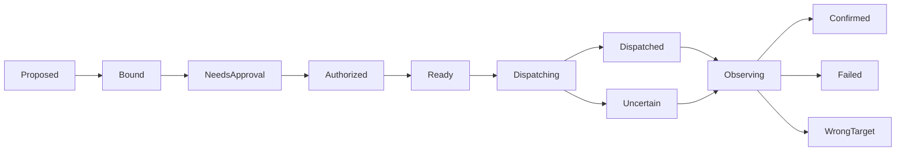
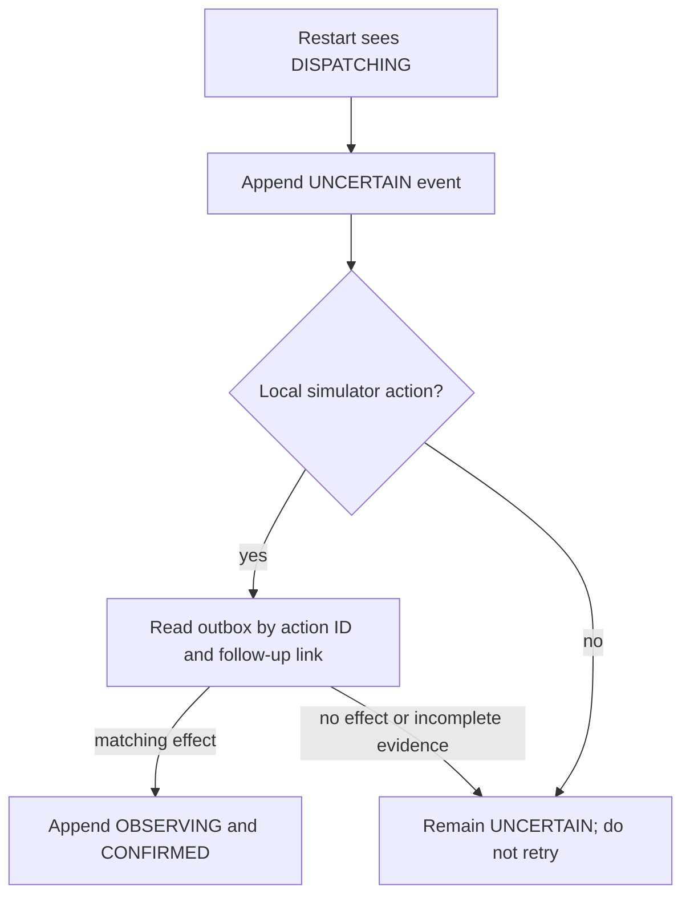

# RESOLVE — Wispr & Solve

**Speak your goal. Your computer gets it done.**

RESOLVE is a Windows-first computer-use prototype for tasks where acting on the correct person, document version, and current user instruction matters. The current release implements a local mission dashboard, two parallel read-only resolver specialists, an action ledger, guarded Win32 input, and a stateful CRM/report/outbox simulator. It remains an early build: the simulator mission is not yet performed through three separate application windows, and no external email is sent.

## Start on Windows

Requires Windows 10/11 x64 and Python 3.11 or newer. Verified on Windows 11 x64 with Python 3.14.7. The core uses the Python standard library; Pillow is optional for screenshot capture.

```powershell
.\scripts\bootstrap.ps1
.\scripts\dev.ps1
```

Or run `python .\src\resolve_app.py`, then open **http://127.0.0.1:8765**. The local database is created automatically under `data/resolve.sqlite3`. Stop with Ctrl+C. There are no mandatory paid API credentials. The dashboard binds to loopback only.

## Try the sample mission

1. Press **Run resolver agents**. The contact and report specialists inspect local records in parallel and return actual candidate records.
2. Choose Northwind's Alex Morgan from two same-name contacts and choose the latest Northwind report by modification timestamp. The old report and wrong client are refused.
3. Press **Prepare send for approval**. Review the exact recipient ID, attachment, and action digest.
4. Press **Approve exact action**. The local simulator writes one action-scoped outbox message and updates the linked follow-up record in one SQLite transaction. A separate read checks the persisted IDs and link before showing `CONFIRMED`.
5. Revise the mission with “Do not send the report.” The mission pauses and blocks old approvals. A new clear approved-send request can reactivate it.

The Voice Console uses browser Web Speech Recognition when available. It transcribes into an editable field; the user reviews the words and can say **“Resolve submit”**. Exact demo commands include **“Resolve discover,” “Resolve choose Northwind Alex,” “Resolve choose latest report,” “Resolve prepare,” “Resolve approve simulated send,”** and **“Resolve stop.”** Approval still uses the reviewed action digest. Browser SpeechSynthesis can narrate status after the user enables **Narration**. Browser support, microphone permission, and possibly the browser's speech service are required. These spoken flows have not been tested with a microphone in this build. The app does not claim a Wispr Flow runtime API.

The Live Computer panel observes real top-level Win32 windows and issues short-lived, per-window snapshots. Physical input requires the same foreground HWND, PID, bounds, observed focus generation, and a current mission revision. A user can move the actual pointer, click, type, and capture the selected foreground window; emergency stop revokes the cursor lease and stops later input batches. Optional read-only [UI Automation inspection](docs/UIA.md) shows element metadata when its package is installed. [Windows control details](docs/WINDOWS_CONTROL.md) include the controlled Tk demonstration procedure and limits. The [controlled-window screenshot](data/evidence/window-e224ce0d94e24b7e89fe0468a515e164.png) shows typed test text; the [dashboard screenshot](data/evidence/dashboard.png) shows the real local UI.

## Implemented architecture







The mission contract retains the original request and every revision. The local interpreter recognizes the sample send-after-approval form and explicit stop-send instructions; other text enters `NEEDS_CLARIFICATION` and cannot dispatch the simulator send. Agents are trusted in-process specialists with task budgets and durable task events. A SQLite cursor lease with fencing serializes cooperating RESOLVE workers, and the Win32 adapter uses a second process lock around actual input. The ledger records `DISPATCHING` before the simulator effect, so a crash window is visible after restart. It does not promise universal exactly-once behavior.

## Verification and benchmark

Run the regression suite with `python -m unittest discover -s tests -v`. For a controlled physical-input check, run `.\scripts\windows_demo.ps1` and see [the Windows runbook](docs/WINDOWS_CONTROL.md). The regular suite skips physical input.

Run `.\scripts\benchmark.ps1` to regenerate the [raw cases](data/benchmarks/raw.jsonl), [separate ground truth](data/benchmarks/ground_truth.jsonl), and [aggregate report](data/benchmarks/aggregate.json). The checked-in seed-11 run has eight targeted SQLite cases per policy: baseline A 1/8 correct, baseline B 2/8, and guarded system C 8/8. These are small, deliberately targeted simulator results, not a live Windows reliability estimate. [Benchmark method](docs/BENCHMARK.md) records the policies, faults, and measurement limits.

## Safety, attribution, and next work

The service accepts requests on loopback, checks Host and Origin, and requires a per-process token for mutations. This does not isolate untrusted code running under the same Windows user. UAC, elevated windows, and secure desktops are not bypassed. Browser dictation may use a browser speech service. Do not enter secrets into the demo fixtures.

No competitor code is copied into this repository. This project's source is MIT licensed; [prior-art review](docs/RESEARCH.md) identifies overlapping voice, Windows automation, verification, and agent work. The broad product concept is not claimed as new. Wispr Flow may be used by the developer to dictate prompts and documentation; authentic Wispr usage evidence must be captured from a real account for a hackathon submission.

Next engineering work is UI Automation semantic targeting, offline voice and spoken feedback, separately instrumented application windows, broader fault injection and ablations, skill learning, and packaging. See [TASKS.md](TASKS.md), [PROGRESS.md](PROGRESS.md), [feature matrix](docs/FEATURE_MATRIX.md), [known limitations](docs/KNOWN_LIMITATIONS.md), and [demo runbook](docs/DEMO.md).
